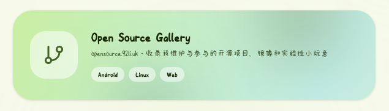

# Open Source Repo Gallery - opensource.92li.uk Source Code



## Browser regression tests

The page is static. To run the offline Chromium tests and the repeatable 4× CPU
throttled grid benchmark, install Node.js and Playwright, then run:

```sh
npm install --no-save playwright@1.57.0
npx playwright install chromium
node tests/browser.cjs
```

Use `node tests/browser.cjs --bench-only` to print timings without assertions.
The test server is local and external API, font and image responses are mocked.

## 🗂️ License

repoGallery is released under the GNU Affero General Public License v3.0 (AGPLv3).

Copyright (C) 2026 lingyicute.

This program is free software: you can redistribute it and/or modify
it under the terms of the GNU Affero General Public License as published by
the Free Software Foundation, either version 3 of the License, or
(at your option) any later version.

This program is distributed in the hope that it will be useful,
but WITHOUT ANY WARRANTY; without even the implied warranty of
MERCHANTABILITY or FITNESS FOR A PARTICULAR PURPOSE.  See the
GNU General Public License for more details.

You should have received a copy of the GNU Affero General Public License
along with this program.  If not, see https://www.gnu.org/licenses.
